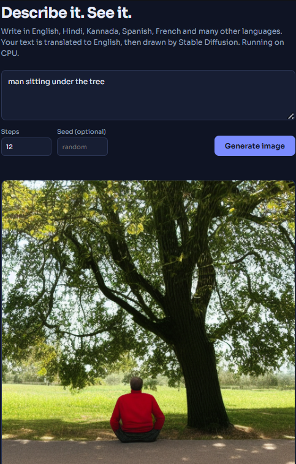

# Multilingual Text-to-Image Generator

Type a description in any language (English, Hindi, Kannada, Spanish and more) and get an AI-generated image in your browser.



## How It Works

1. You type a prompt in the web page.
2. The Flask backend detects the language and translates it to English (Helsinki-NLP opus-mt-mul-en).
3. Stable Diffusion v1.5 generates an image from the English prompt.
4. The image is shown in the browser, with a download button.

No model was trained here. The project connects pretrained models into a working web app.

## Features

- Prompts in many languages with automatic translation
- Adjustable steps and optional seed for repeatable results
- Download the image as PNG
- Runs on CPU, and uses the GPU automatically if available

## Tech Stack

Python, Flask, PyTorch, Hugging Face diffusers and transformers, langdetect, HTML, CSS, JavaScript

## Setup

You need Python 3.10 or newer, about 8 GB of RAM and about 8 GB of free disk space.

```bash
git clone https://github.com/YOUR-USERNAME/text-to-image-generator.git
cd text-to-image-generator

python -m venv venv
venv\Scripts\activate          # Windows
source venv/bin/activate       # macOS / Linux

pip install -r requirements.txt
python app.py
```

Wait for `Ready.` in the terminal, then open **http://127.0.0.1:5000** in your browser.
The first run downloads several GB of models, so it takes a while.

## Tips

- Detailed prompts work best: `an old Indian woman sitting under a banyan tree, realistic photo, soft light, highly detailed`
- On CPU, each image takes a few minutes. Use 20 to 25 steps for good quality and 12 for quick tests.
- With an NVIDIA GPU, generation takes seconds.

## Troubleshooting

- **"Unexpected end of JSON input":** open http://127.0.0.1:5000, not the HTML file directly.
- **Model download error (401):** set the `MODEL_ID` environment variable to another Stable Diffusion model.
- **"Internal Server Error":** check the terminal for the full error message.

## Limitations

Slow on CPU, older model so faces and hands can look imperfect, and translation is not always perfect.

## Credits

[Stable Diffusion](https://github.com/CompVis/stable-diffusion), [Hugging Face](https://huggingface.co), [Helsinki-NLP OPUS-MT](https://huggingface.co/Helsinki-NLP/opus-mt-mul-en)
